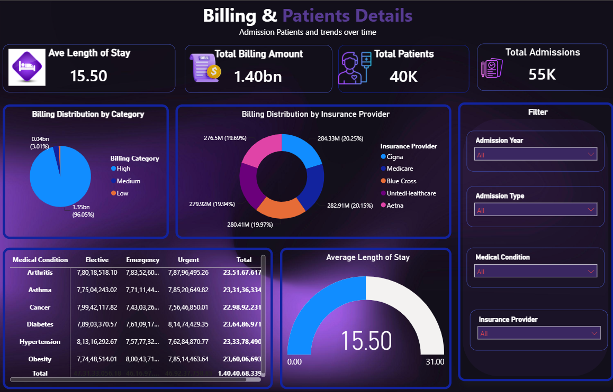
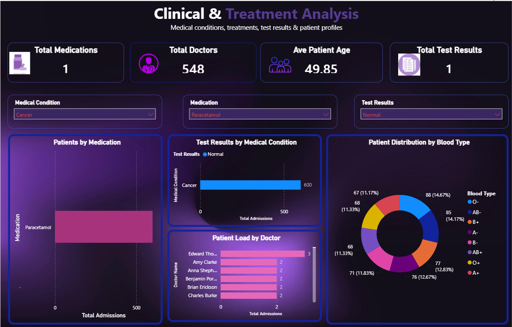
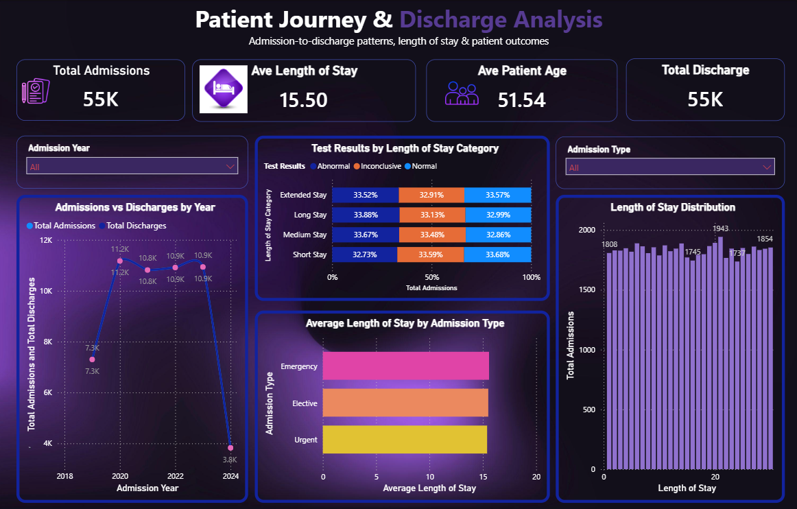

# 🏥 Healthcare Patient Admissions Dashboard

## Overview
An interactive 6-page Power BI dashboard that tracks hospital admissions, billing, and length of stay.

## Tools Used
Power BI, DAX, Power Query

## What I Did
- Built a 6-page interactive dashboard using a **star schema** data model
- Wrote **DAX measures** to calculate key metrics
- Cleaned and transformed data with **Power Query**
- Used KPI cards and drill-down visuals to analyze admission trends and billing patterns

## Dashboard Preview

## Key Metrics Tracked
- Total admissions
- Billing amount
- Average length of stay

## Files
- `Healthcare patient admissions analysis.pbix` – Power BI file (download and open with Power BI Desktop)
- `images/` – dashboard screenshots

## Dataset
Sample healthcare dataset.
